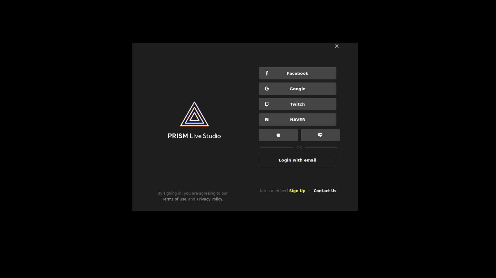
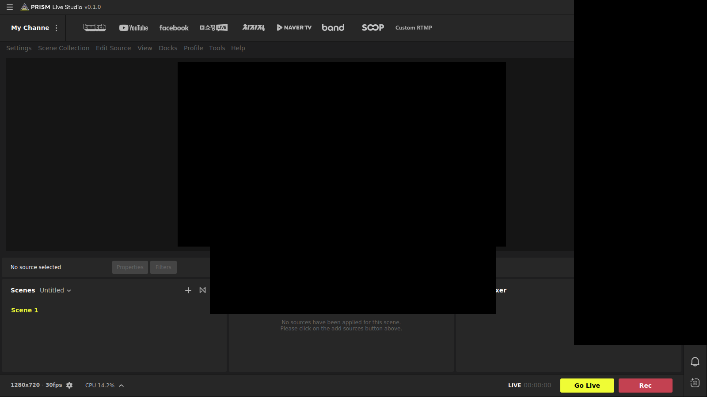

# HopCast

A Linux port of [PRISM Live Studio](https://github.com/naver/prism-live-studio), with a portable **AppImage** as the target.

> **Name note.** "HOPCAST" is a registered US mark (Reg. 6425832, John I. Haas, Inc.) limited to podcasts about hops and beer,
> a different market from streaming software. Low conflict risk; get a quick professional clearance before any commercial use.
> (The earlier codename "Hopper" was dropped: DISH Network owns and enforces it for TV-streaming products.)

## Legal

- This is a fork of PRISM Live Studio © NAVER Corp., licensed **GPL-2.0** (see `/COPYING`, `/LICENSES`).
  Our changes are also GPL-2.0-or-later. Full source must ship with every binary.
- The engine is NAVER's fork of OBS Studio (`src/obs-studio`, GPL-2.0-or-later), pinned at `a357328` (libobs 31.0.3).
- Not affiliated with or endorsed by NAVER Corp. or the OBS Project. "PRISM", "PRISM Live Studio" and "OBS"
  are their owners' marks. We don't use them as our name and won't ship their logos.
- No NAVER backend services, telemetry, or credentials. No account logins: HopCast streams to any RTMP/SRT/RIST server you enter.

## Layout

Our additions live under `hopcast/` and `.github/workflows/hopcast-*.yml` so upstream merges stay clean.

```
hopcast/scripts/deps-ubuntu.sh       build deps, Ubuntu 24.04+ (FFmpeg >= 6.1 required)
hopcast/scripts/deps-arch.sh         build deps, Arch / CachyOS
hopcast/scripts/build-engine.sh      Phase 0: build the pinned engine (no UI)
hopcast/scripts/smoke-test-engine.sh Phase 0: headless engine + plugin load test
hopcast/tests/engine_smoke.c
hopcast/scripts/build-app.sh         Phase 1: build PRISM's layer, stage engine+app into build/stage
hopcast/scripts/launch-test-app.sh   Phase 1: run the staged app under Xvfb (gdb backtrace + screenshot)
hopcast/cmake/prism-linux.cmake      Linux-wide CMake adjustments + install layout for PRISM's tree
hopcast/engine-patches/              patch series applied to the pinned engine submodule
```

## Phase 0 — build the engine

```bash
bash hopcast/scripts/deps-arch.sh        # or deps-ubuntu.sh
bash hopcast/scripts/build-engine.sh
bash hopcast/scripts/smoke-test-engine.sh
```

Expected output ends with `PASS`.

### Phase 0 status: ✅ passing in CI (2026-10-09)

Verified on Ubuntu 24.04 (GitHub Actions, Xvfb + Mesa software GL):

```
libobs 31.0.3 started
video: OpenGL renderer up
audio: 48 kHz stereo up
input types registered: 17
  ffmpeg_source / v4l2_input / pulse_input_capture / image_source / color_source_v3  ok
created source 'smoke-color' (320x180)
PASS
```

What it took (NAVER's engine had never been built on Linux):

| Fix | Where |
|---|---|
| Export `PLS_VERSION` & friends (engine hard-requires them) | `build-engine.sh`, `hopcast/VERSION` |
| No-op `legacy_check()` (removed by NAVER, still used by obs-websocket) | `hopcast/cmake/engine-compat.cmake` |
| Skip macOS-only Objective-C `libobs/pls/*.m` on Linux | `hopcast/cmake/engine-compat.cmake` |
| Warnings not fatal (NAVER prints `uint64_t` with `%llu`) | `build-engine.sh` |
| `libobs/pls`: missing includes, Linux values, "no PRISM Lens" stubs | `engine-patches/0001` |
| POSIX `os_process_pipe_set_userdata()` (Windows-only, used by obs-ffmpeg) | `engine-patches/0002` |
| NVENC: Windows `FALSE` macro and MSVC `__try/__except` | `engine-patches/0003` |

Engine features **off for now**: browser source (CEF), websocket, WebRTC, VLC, scripting,
AJA/DeckLink, and the **VST host** (NAVER rewrote it for Windows/macOS only).

## Phase 1 — PRISM's own interface on Linux

### Status: ✅ builds, links and launches in CI (2026-10-11)



- All of PRISM's common-libs and the PRISMLiveStudio app compile and link on Ubuntu 24.04 with Qt 6.8.3.
- `build-app.sh` stages a runnable tree in `build/stage` (engine install + app on top):
  `bin/PRISMLiveStudio`, `lib/` (libobs, PRISM libs, RPATH `$ORIGIN/../lib`), `lib/obs-plugins/`,
  `lib/hopcast/plugins/` (PRISM plugins), `share/obs/`, `share/hopcast/data/prism-studio/`.
  This is also the AppDir layout for the AppImage.
- CI launch test: the app starts, stays up for 30 s and shows PRISM's login window.
  Network requests fail cleanly because NAVER's public source ships with no server URLs.

Startup fixes made to get here (all marked `HopCast` in the source):

| Problem | Fix |
|---|---|
| `bringWindowToTop`, `system_info` undefined at link | Linux implementation in `platform-x11.cpp`; build `system-info-posix.cpp` |
| Stack overflow at startup in `findFileInResources` | Skip `.`/`..` (upstream bug, triggered by an empty path); Linux uses the shared POSIX gpop defaults |
| No Linux data layout | Generic install rules + `share/hopcast` data paths (`GetDataFilePath`, locale.ini, plugin path) |
| Null `PLSBasic` in side-bar hide event during construction (X11 realizes docks early) | Guarded |

### No accounts, no NAVER services, no PRISM branding

PRISM normally won't open its studio until you sign in with a PRISM account, and its account,
update, notice, banner, resource and channel-sync features all run on NAVER's servers. HopCast has
no right to use those servers (and the public source has none of their addresses or keys), so two
CMake options, both on by default, remove them:

- `HOPCAST_NO_ACCOUNT` — no login window, no File › Logout, no Settings › General › Account.
- `HOPCAST_NO_NAVER`
  - **Hard network block:** `libhttp-client` refuses any request to a NAVER-operated host
    (naver.com/.net, navercorp.com, pstatic.net, prismlive.com, NAVER Cloud, band.us, …) and any
    unset endpoint, before a connection is made. The launch test reports blocked/leaked requests.
  - **No NAVER calls at all at startup:** PRISM token, app-init, gpop, update check, notices,
    thumbnails, banner and the resource CDN are skipped; bundled defaults are used.
  - **Custom RTMP channels are saved locally**, encrypted (see *Stream keys* below), instead of
    on NAVER's server.
  - **Channels:** NAVER TV, BAND, Shopping Live, CHZZK, NCB2B, Whale and NOW removed.
- **No platform gets special treatment.** The channel bar has only **Custom RTMP**: Twitch,
  YouTube, Facebook and SOOP buttons are gone, the Custom RTMP dialog has no list of suggested
  platforms (just RTMP / SRT / RIST), it doesn't switch into Twitch/YouTube modes based on the
  server address, and HopCast no longer contacts Twitch at startup. Any service that gives you a
  server URL and stream key (Twitch, YouTube, Kick, Rumble, Odysee, Owncast, your own server…)
  works the same way. HopCast makes no network requests at startup.
  - **Removed pop-ups:** welcome/banner window, PRISM Lens onboarding. Help menu keeps only Program Info.
  - **Name:** title bar text "HopCast" with no logo image; window and tray title "HopCast" with
    the desktop theme's generic camera icon.



(The black area on the right in CI screenshots is the translucent chat panel, which needs a
compositor to draw; on a normal desktop it renders normally.)

### Stream keys are encrypted

Everything that holds a stream key or a platform token is encrypted on disk by HopCast
(`hopcast/securestore`, tests in `hopcast/tests/secure_store_test.cpp`):

| File | Contents |
|---|---|
| `hopcast-rtmp-channels.enc` — **in the folder you choose** | your Custom RTMP channels (server + stream key) |
| `~/.config/PRISMLiveStudio/Cache/channel_cache.dat.enc` | PRISM's channel cache (all channels, keys, tokens) |

- **You choose where the stream-key file lives.** The first time you save a stream key, HopCast
  asks and opens a folder picker (your Documents folder is suggested); "Use HopCast's Folder"
  keeps it in `~/.config/PRISMLiveStudio/user/`. HopCast remembers the choice; **Tools › Stream Key
  Storage…** shows where it is and moves it to another folder (it never overwrites a file that's
  already there).
- **AES-256-GCM.** The files can't be read without the key, and any change made outside HopCast
  is detected: the file is not loaded, it's set aside as `….unreadable-<time>`, and HopCast tells
  you to re-enter your keys. Only HopCast, when you change a key in the app, writes these files
  (atomically, mode 0600).
- **The key is a separate owner-only file**, `~/.local/share/hopcast/secure-store.key` (mode 0600),
  kept apart from the encrypted data in `~/.config` — so a copy or dotfile backup of `~/.config`
  alone holds only locked data. **No keyring is used** (no KWallet / GNOME Keyring; decided
  2026-10-11). Keep that key file if you back up or move your HopCast data — without it the
  encrypted files can't be opened. (A keyring-backed key is still in the code behind the CMake
  option `HOPCAST_USE_KEYRING`, off by default.)
- **Key file missing later?** HopCast won't overwrite data it can't read: your saved channels stay
  untouched, HopCast tells you, and saving is paused until the key file is back.
- **No plaintext copies:** older plaintext files (`hopcast-rtmp-channels.json`, `channel_cache.dat`)
  are encrypted and then overwritten and deleted on first start. `service.json` no longer stores
  the key (it's re-applied from your channel at every Go Live), and PRISM's unmasked "KR" log
  lines — which printed keys and tokens — are dropped.
- **Limits, honestly:** the key file protects against other users on the PC, against someone who
  only gets the data file or your `~/.config`, and against edits — but anyone or any program that
  can read your *whole* home folder as you can read both files. (An optional HopCast master
  password could close that gap later.) HopCast has to decrypt a key in memory to stream with it,
  and the key is sent to your streaming platform when you go live — that's how RTMP works. On SSDs, overwritten old plaintext files may still
  physically linger until the drive reuses those blocks.

### UI map (screenshots of every screen)

[`hopcast/docs/ui-map/`](docs/ui-map/README.md) shows every button and menu and what it opens,
one folder per area (start, channels, menus, scenes, settings, sidebar, bottom). The screenshots
come from the automated UI tour: run the `hopcast-app` workflow with **ui_tour** checked
(scenarios in `hopcast/tests/ui-tour.txt`), then regenerate with
`hopcast/scripts/ui-map.py <tour-dir>`.

Also removed in the cleanup pass: PRISM/NAVER/OBS links in Help (only Program Info and Open
Source License remain), the PRISM logo and update check in Program Info (now "HopCast" with the
GPL credit), the account avatar, PRISM Lens, PRISM/GIPHY stickers, scene templates and NAVER
business settings in the sidebar, the sidebar's output setting guide (!) and help (⋯) buttons
(plus the guide link in the Custom RTMP dialog), the platform chat panel (whose "Add PRISM Chat Source" button
crashed), the "recommended sources" upsell in Add Source, and the "DialogView" placeholder title.

### Runtime audit (what a real desktop would hit)

The `hopcast-audit` workflow (run it manually) builds the app normally and with
AddressSanitizer/UBSan, then runs [`hopcast/scripts/audit-runtime.sh`](scripts/audit-runtime.sh).
Results go to the `ci-logs-audit-normal` / `ci-logs-audit-asan` branches (`summary.txt` first). It:

- starts a sound server (PulseAudio null sink, like PipeWire on a desktop);
- adds a Custom RTMP channel, **streams to a real RTMP server** (ffmpeg on 127.0.0.1) and checks
  the video and audio that arrive, then drops the connection to check reconnecting;
- records before and after streaming and plays the files back;
- checks the stream key is never in plain text in the profile or logs, including while live;
- quits with Ctrl+Q, starts again on the same profile, then starts and quits 8 more times;
- starts on Wayland (weston, headless); checks every binary resolves its libraries;
- watches for the app closing its own stdin/stdout/stderr (`hopcast/tests/fd0-guard.c`);
- runs static analysis (compiler warnings + cppcheck) on the files HopCast changed.

Fixed because of it (2026-10-14):

| Problem on a real desktop | Cause | Fix |
|---|---|---|
| Go Live always failed | PRISM registered each broadcast with NAVER's server first | stream directly to the channel's server |
| Stream ended right after starting | live-time limit read from NAVER's (empty) policy file = 0 min | no limit |
| Settings › Exit / Ctrl+Q did nothing | Exit only connected on macOS | connected on Linux |
| App sometimes hung on its loading screen | engine fork()ed the threaded app to inspect plugins (deadlock) | read the plugin's ELF header instead (engine patch 0004) |
| Recording after a stream produced no file | virtual camera output closed fd 0 it didn't own on every output reset; helper then started without stdin | patches 0007, 0008 |
| Stream key written in plain text while live | crash-recovery file; upstream `pls_encrypt_json` is a plain write | stored with the secure store |
| Stream key in the system journal | RTMP server echo logged verbatim | masked (patch 0005) |
| Background NAVER activity | notice/update polling, MQTT (outside the network block), Lens IPC retry every 3 s, 9 sign-in plugins loaded | removed |

Multi-channel streaming (one stream to several servers) went through NAVER's relay. HopCast
streams to one channel per output (horizontal, plus vertical with dual output) and says so if
more are switched on.

### Next in Phase 1

- Remaining PRISM naming under the hood: translations, the `PRISMLiveStudio` config folder and
  binary name, NAVER image assets — full rebrand pass.
- PRISM source plugins (timer, text template, chat, sticker, …) on Linux.
- Real-desktop test on CachyOS (X11 and Wayland).

## AppImage target

- Built in CI on a fixed Ubuntu 24.04 image → runs on glibc ≥ 2.39 (CachyOS, Arch, Fedora 40+, Ubuntu 24.04+).
- Engine is built relocatable + portable-config so it runs from inside the AppImage mount.
- Releases are tagged and never rebuilt, so a given AppImage version always stays the same.
